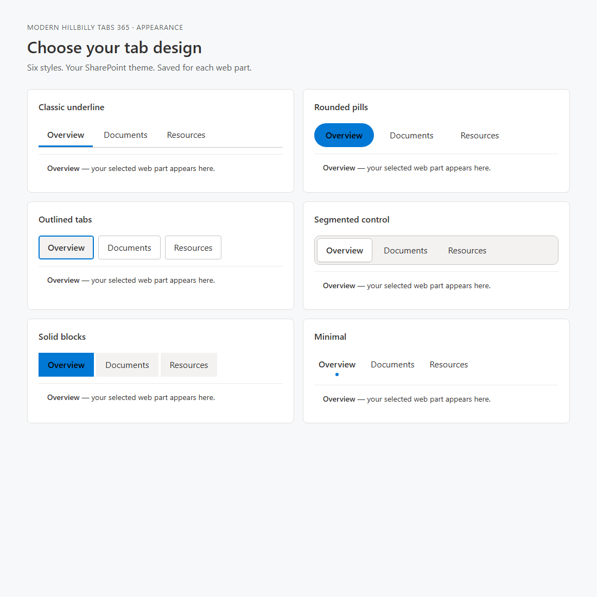
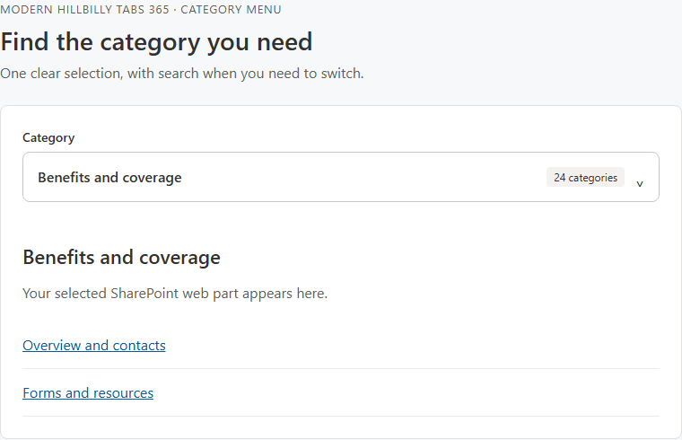

# Modern Hillbilly Tabs 365

Display neighboring SharePoint page web parts using selectable tabs or a searchable category menu. Choose from six tab designs and three alignments. The compact menu helps people navigate pages with many categories while keeping the current selection clear. Existing tab labels and saved web part references are preserved.

## About

**SharePoint compatibility update by Dr. Ghassan Abukar, Ph.D.**

Original Modern Hillbilly Tabs project by **Mark Rackley**.

Version: **1.2.0** · SharePoint solution version: **1.2.0.0**.

See the [changelog](CHANGELOG.md) for release details and upgrade instructions.

## Install or update

Download the installation package and complete source archive from [GitHub Releases](https://github.com/drghassanabukar/modern-hillbilly-tabs-365/releases/latest).

1. Use the included `modern-hillbilly-tabs.sppkg` from the download, or build it as described below.
2. Upload it to your SharePoint App Catalog. For an existing installation, replace the previous package and deploy the update. The original solution and web part IDs are preserved.
3. If SharePoint offers an app update on the target site, apply it. Refresh the page after the updated assets become available.
4. Test on a page before using it broadly: select every tab, edit the page, publish, and reopen it. Existing labels should remain.
5. If a tab reports an unavailable web part, open **Manage Tab Labels** and reselect the intended web part from the same section.

Solution ID: `86a6b96a-7f98-4508-827d-b8bd6409f60b`

Web part ID: `6bcd9bfc-425b-47c2-8e5e-c17eb1c864c5`

## Configure

1. Use a standard page section. Place the tabs web part above the content web parts in the same column and section.
2. Edit the tabs web part, then choose **Manage Tab Labels**.
3. Choose a web part and enter a tab label for each row. Rows determine tab order.
4. Publish the page. Only the selected content appears. Content remains visible in edit mode.

The legacy `sectionClass` and `webpartClass` properties remain as optional class-name overrides. Standard markup is detected automatically. Each content web part should belong to one tab set. Content remains in its original canvas location; the update does not move web parts between columns or sections.

Tab buttons support Left/Right Arrow, Home, End, Enter, and Space. Unavailable or already-owned content is disabled with an explanatory message. Labels are rendered as text.

## Choose a tab design

Site administrators and page editors with permission to edit the page can select a design for each tabs web part:

1. Edit the SharePoint page and open the tabs web part's properties.
2. Expand **Appearance** and choose **Navigation layout**: Tab bar, Searchable category menu, or Automatic.
3. Choose **Tab design** and **Tab alignment**: Left, Centered, or Full width.
4. Try the sample tabs in **Design preview**, then republish the page.

| Design | Appearance |
| --- | --- |
| Classic underline | Familiar tabs with a line under the selected label; the default for existing pages. |
| Rounded pills | A rounded filled selection with open space between labels. |
| Outlined tabs | Individual bordered tabs with a stronger selected outline. |
| Segmented control | Tabs grouped on one shared track. |
| Solid blocks | Rectangular filled tabs with a strong selected color. |
| Minimal | Plain labels with a small marker below the selected tab. |

Designs follow the SharePoint page or section theme, including dark sections. The text on filled selections adapts to the theme accent for contrast. Long labels wrap on narrow screens, and every design supports the same keyboard navigation. Appearance settings are saved per web part; existing labels and content selections are preserved.



### Pages with many categories

Choose **Searchable category menu** for pages with many categories. It replaces several rows of tabs with one clear current-category heading and category count. Open the chooser to search category labels, then select a result to change the displayed web part. Searching does not change the current content. The chooser closes after selection and supports Up/Down, Home/End, Enter, and Escape.

**Automatic** uses this menu when there are more than eight categories. New web parts default to Automatic; existing saved web parts keep their tab bar until an editor changes this setting. The edit preview follows the chosen layout and uses sample content.



## Updates and admin notices

Deploy version **1.2.0** once to enable update notices. Site owners see an in-page notice when a newer release is available. In page edit mode, the **Updates** section always shows the loaded addon version, status, and **Check for updates** button. Ordinary page readers do not make release-check requests or see this admin panel.

- **Download update** opens the newer installation package. An administrator must upload and enable it in the SharePoint App Catalog.
- **Release notes** explains what changed.
- **Already deployed? Reload page** refreshes the page after the package has been deployed. Save or publish page changes first. Reloading does not install a package.

The loaded version helps distinguish an old browser session from a newer deployed package. This release does not query App Catalog deployment state, so the reload action is conditional guidance rather than proof that an update is already installed.

Checks use the latest stable public GitHub release for this repository and require a ready-to-download `modern-hillbilly-tabs.sppkg` asset. Publishing a source commit alone does not trigger an update notice. After changing the addon, increment its component/package versions and build it. Create a draft release tagged `vX.Y.Z`, attach the installation package, and then publish the release so the download is ready when notices appear.

Successful checks are cached in the browser session for one hour and shared across web parts. **Check for updates** can refresh the cached result, subject to a short request cooldown and GitHub rate limits. If the network blocks the check, the tabs continue working and editors can use **Open releases**. Turn checks off under **Updates → Check for addon updates** if required.

The request contains no user name, page content, tab labels, or tab settings. It uses no authentication token or cookies and suppresses the page referrer. GitHub still receives normal browser network metadata, including the IP address and the site origin required for a cross-origin request.

For release emails while an admin is away from SharePoint, use **Watch → Custom → Releases** on this repository and enable email notifications in GitHub. See [GitHub's notification guide](https://docs.github.com/en/subscriptions-and-notifications/get-started/configuring-notifications). The addon itself does not send email or run while the page is closed.

## What changed

- Repairs Searchable and Automatic menus when the host cancels native click or keyboard actions.
- Adds owner/editor update notices, loaded-version information, and separate installation and reload guidance.
- Removes the original-project link from the addon and current README while retaining plain-text attribution.
- Adds six tab designs, three alignments, and an interactive preview in edit mode.
- Adds a searchable category menu for long category lists, with an Automatic layout for new web parts.
- Follows SharePoint page and section theme colors, including dark sections and readable text on filled selections.
- Detects legacy `ControlZone` wrappers, `CanvasControl` automation attributes, and feature instance IDs.
- Matches saved GUIDs and legacy `control_<guid>` references to their newer identity attributes.
- Responds to late rendering and replaced controls for the web part's lifetime.
- Changes visibility in place, avoiding the original approach of moving SharePoint-owned DOM nodes.
- Restores original visibility and accessibility attributes on re-render, edit mode, and disposal.
- Limits discovery to the current section and prevents two tab sets from controlling the same element.
- Replaces the global jQuery tab plugin with instance-scoped tab buttons and keyboard support.
- Updates the build to SPFx 1.21.1, TypeScript 5.3, and Node.js 22.

## Build

Use **Node.js 22.14 or newer in the 22.x line**. The `.nvmrc` file records the selected runtime. No global gulp installation is required.

```sh
npm ci
npm test
npm run package
```

To run the browser regressions as well:

```sh
npx playwright install chromium
npm run test:browser
```

The production package is created at:

```text
sharepoint/solution/modern-hillbilly-tabs.sppkg
```

For local development:

```sh
npm run build
npx gulp trust-dev-cert
npx gulp serve
```

## Validation and compatibility limits

The automated DOM regression suite exercises the actual web part renderer and simulated legacy and newer SharePoint markup. Coverage includes the six designs, the 24-category menu, filtering, keyboard and focus behavior, theme changes, edit previews, delayed rendering, content restoration, update notices, and viewer permissions. Chromium regressions replay host-cancelled native actions against the real menu controllers. Additional browser checks cover desktop and 375px widths, including dark and forced-color themes. The original implementation failed the newer-markup and delayed-rendering scenarios before the compatibility repair.

**This update has not been verified in your SharePoint tenant.** Confirm the deployment on your affected page. Flexible sections and future canvas markup changes require separate validation; use a standard section for this release.

SharePoint Online supports older SPFx releases, so the old SDK version alone does not explain the runtime failure. Microsoft also documents that the page DOM and CSS are implementation details rather than a supported extensibility API. This solution still depends on those details to control neighboring web parts, so future SharePoint changes may require another compatibility update.

Primary references:

- [Microsoft SPFx compatibility reference](https://learn.microsoft.com/en-us/sharepoint/dev/spfx/compatibility)
- [SharePoint Framework overview and page DOM guidance](https://learn.microsoft.com/en-us/sharepoint/dev/spfx/sharepoint-framework-overview)
- [Microsoft SPFx 1.21 release notes](https://learn.microsoft.com/en-us/sharepoint/dev/spfx/release-1.21)

## Disclaimer

Provided as is, without warranty. This repository retains attribution to the original project.
